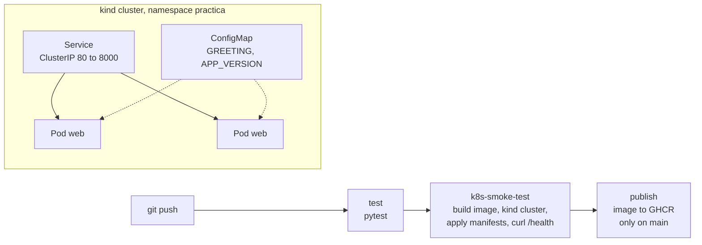

# docker-k8s-practice

[](https://github.com/ElBaArto23/docker-k8s-practice/actions/workflows/ci.yml)

A small Flask API, packaged with Docker, deployed to Kubernetes (kind) and verified by a
GitHub Actions pipeline that also publishes the image to GitHub Container Registry.

I built it to learn the container workflow end to end: write the image, run it, deploy it to a
cluster, break it on purpose, and automate the checks. The application is intentionally simple;
the interesting part is everything around it.

## What it demonstrates

- **Docker:** `python:3.12-slim` image, dependency layer cached separately, non-root user,
  `HEALTHCHECK`, `.dockerignore`, and Docker Compose for local development.
- **Kubernetes:** Namespace, ConfigMap, Deployment (2 replicas, rolling update with
  `maxUnavailable: 0`, readiness and liveness probes, resource requests and limits) and a
  ClusterIP Service.
- **CI/CD:** GitHub Actions runs unit tests, builds the image, deploys it to an ephemeral kind
  cluster with a smoke test, and publishes the image to GHCR from `main`.

## Architecture



## Endpoints

| Path | Response |
| --- | --- |
| `/` | JSON with `message` (from `GREETING`), `version` (from `APP_VERSION`) and the pod `hostname` |
| `/health` | `{"status": "ok"}`, used by the health check and the Kubernetes probes |

## Run it

Requirements: Docker, and for the Kubernetes part [kind](https://kind.sigs.k8s.io/) and `kubectl`.

```bash
# Docker
docker build -t practica-app:local .
docker run --rm -p 8000:8000 practica-app:local
curl localhost:8000/health

# Docker Compose
docker compose up --build

# Kubernetes (kind)
kind create cluster --name practica
kind load docker-image practica-app:local --name practica
kubectl apply -f k8s/
kubectl -n practica get pods
kubectl -n practica port-forward svc/practica-app 8080:80
curl localhost:8080/

# Clean up
kind delete cluster --name practica
```

The manifests use `imagePullPolicy: IfNotPresent` because the image is loaded into the cluster
with `kind load`; it is not pulled from a registry.

## What I practiced on the cluster

- **Self-healing:** deleted a pod and watched the Deployment create a replacement.
- **Scaling:** scaled from 2 to 4 replicas and back with `kubectl scale`.
- **Rolling update and rollback:** built a `v2` image, updated with `kubectl set image`, followed
  `rollout status`, and reverted with `rollout undo`.
- **Failing probe:** pointed the readiness probe at a path that does not exist (`/nada`). The new
  pods returned 404 on the probe, never became Ready, and the old pods kept serving traffic, so
  the bad version never received requests.
- **Debugging:** `describe`, `logs`, `get pods -o wide` and `rollout history`.

Not covered yet: forcing an `OOMKilled` with a very low memory limit, an Ingress, and Helm.

## CI/CD pipeline

Defined in [`.github/workflows/ci.yml`](.github/workflows/ci.yml):

| Job | What it does |
| --- | --- |
| `test` | Installs `requirements-dev.txt` and runs `pytest` |
| `k8s-smoke-test` | Builds the image, creates a kind cluster, applies `k8s/`, waits for the rollout and calls `/health` and `/` through a port-forward. Prints pod descriptions and logs if it fails |
| `publish` | On pushes to `main` only, logs in to GHCR with `GITHUB_TOKEN` and pushes the image tagged with the commit SHA and `latest` |

## Tests

```bash
pip install -r requirements-dev.txt
pytest
```

`pytest.ini` sets `pythonpath = .` so the tests can import the `app` package.

## Structure

```
app/                     Flask application
tests/                   unit tests
Dockerfile               container image
docker-compose.yml       local run
k8s/                     Kubernetes manifests (namespace, configmap, deployment, service)
.github/workflows/ci.yml CI/CD pipeline
docs/GUIA_PRACTICA.md    step-by-step practice guide (Spanish)
```

## Lessons learned

- `pytest` and `python -m pytest` differ: the second adds the current directory to the import
  path. The pipeline failed with `ModuleNotFoundError` until `pytest.ini` set `pythonpath`.
- A readiness probe is what keeps a bad release away from users during a rolling update.
- Resource limits need a request and a limit, and both should be sized from real usage.

## Next steps

- Ingress with NGINX on kind.
- Convert `k8s/` into a Helm chart.
- Deploy the same image to AKS with Terraform (see the Azure IaC practice project).
